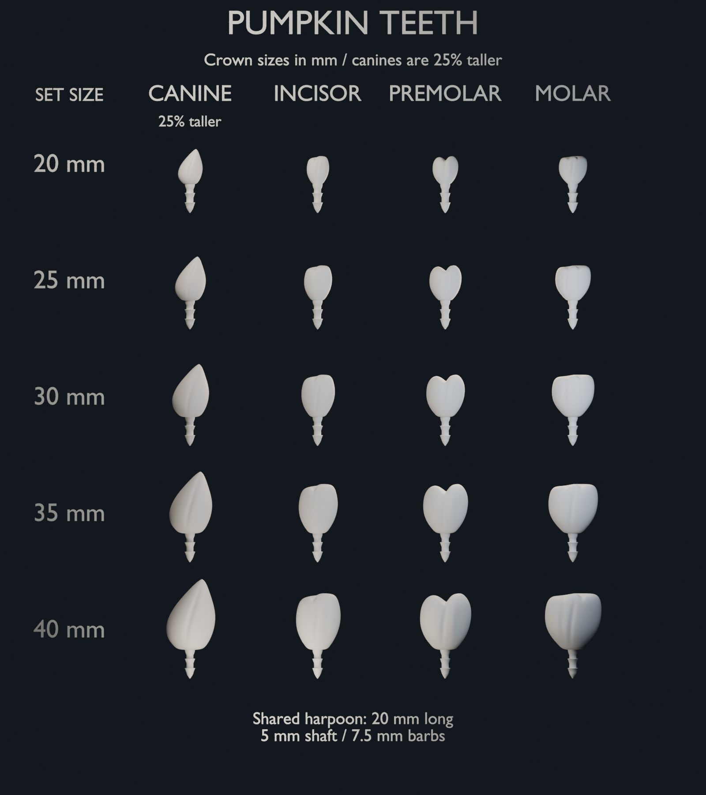

# Jack-o'-lantern teeth

3D-printable pumpkin teeth by [Eric Cheng](http://echeng.com), released under the
[MIT license](LICENSE).

Four rounded, worn tooth designs share a fixed barbed harpoon for inserting into
a carved pumpkin: canine, incisor, premolar and molar. Each comes in five size
sets, with different front and back faces for variety when rotated 180 degrees.

## Download and print

Choose a folder in [sizes/](sizes/) and import its STL files into your slicer at
100% scale in millimeters. Print four copies of each design for four canines and
twelve assorted teeth.

Ready-to-print ZIPs include the four STL designs, mount fit test, printing
instructions and MIT license. Each size pack is about 9–10 MB.

| Size set | Incisor, premolar and molar crown | Canine crown | STL download |
| --- | --- | --- | --- |
| 20 mm | 20 mm | 25 mm | [20 mm ZIP](https://github.com/ehcheng/jackolantern_teeth_3d_print/releases/download/v1.0.0/pumpkin-teeth-20mm-STLs.zip) |
| 25 mm | 25 mm | 31.25 mm | [25 mm ZIP](https://github.com/ehcheng/jackolantern_teeth_3d_print/releases/download/v1.0.0/pumpkin-teeth-25mm-STLs.zip) |
| 30 mm | 30 mm | 37.5 mm | [30 mm ZIP](https://github.com/ehcheng/jackolantern_teeth_3d_print/releases/download/v1.0.0/pumpkin-teeth-30mm-STLs.zip) |
| 35 mm | 35 mm | 43.75 mm | [35 mm ZIP](https://github.com/ehcheng/jackolantern_teeth_3d_print/releases/download/v1.0.0/pumpkin-teeth-35mm-STLs.zip) |
| 40 mm | 40 mm | 50 mm | [40 mm ZIP](https://github.com/ehcheng/jackolantern_teeth_3d_print/releases/download/v1.0.0/pumpkin-teeth-40mm-STLs.zip) |

Every size set uses the same harpoon: 20 mm extending below the crown, a 5 mm
shaft diameter, and a 7.5 mm maximum barb diameter. Overall length is the actual
crown height plus 20 mm. Select a supplied size to preserve the
mount dimensions. Test the [mount sample](project/mount-fit-test-20mm.stl) in your
pumpkin before printing a full set.

The main [README.txt](README.txt) contains printing instructions and Bambu Studio
settings for a lightly filled crown with a solid harpoon. Bambu Studio `.3mf`
project is also included for the 25 mm set. Check its included
models and settings before printing; updating the STLs does not update geometry
already imported into a `.3mf` project.

The [complete design pack](https://github.com/ehcheng/jackolantern_teeth_3d_print/releases/download/v1.0.0/pumpkin-teeth-20-40mm.zip)
includes all 20 STLs, the editable Blender master, preview and documentation,
about 94 MB. All downloads are listed on the [Releases page](https://github.com/ehcheng/jackolantern_teeth_3d_print/releases).

Use **Code → Download ZIP** for the repository, including the maintenance scripts
and 25 mm Bambu Studio project. Regenerate the six release packages with
`python3 scripts/package_teeth.py`. Generated ZIPs are distributed as release
assets and excluded from Git because they duplicate the tracked files.

## Edit the designs

Open [project/pumpkin-teeth-sized.blend](project/pumpkin-teeth-sized.blend) in
Blender, or edit [scripts/build_teeth.py](scripts/build_teeth.py). The generator is
also embedded in the Blender project as `Rebuild teeth.py`.

[README-FOR-CHATGPT.md](README-FOR-CHATGPT.md) explains the parameters, mount
constraints, rebuild workflow and validation requirements for future agents and
human contributors. Scripts use paths relative to this repository. Geometry was
built and checked with Blender 5.2.2 LTS.

## Attribution and license

Copyright © 2026 Eric Cheng. [http://echeng.com](http://echeng.com).

The designs, source and documentation are provided under the [MIT license](LICENSE).
Retain the copyright and license notice when redistributing copies or substantial
portions of this project.
